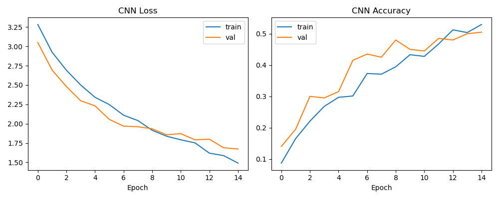
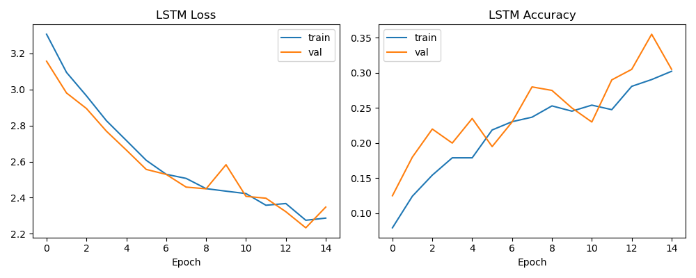

# Ocean Sound Classification

Classifies marine mammal species from short audio clips. Audio is converted to mel-spectrograms with librosa, then a CNN and an LSTM are trained in PyTorch and compared.

## What it does
- Reads `wmms_labels.csv` (columns `file`, `species`) and the clips in `wmms_audio/`.
- Drops species with fewer than 15 clips: **29 species and 1,333 clips** remain (3 species dropped).
- Builds 64-band mel-spectrograms, padded or cut to 130 frames and normalized per clip.
- Splits 933 / 200 / 200 (train / validation / test), stratified by species.
- Trains a 3-layer **CNN** and a 2-layer bidirectional **LSTM** for 15 epochs each on CPU, then saves classification reports, training curves, and confusion matrices.

## Results (200 test clips, 29 classes)
| Model | Test accuracy |
|---|---|
| CNN | 49.5% |
| LSTM | 31.5% |

Random guessing would score about 3.4%. Reports, plots, and the run log are in [`results/`](results/).




## Limitations
- Small dataset and test set (some species have only 3 to 8 test clips), so per-species scores are noisy. Several species score 0.
- Short training, no augmentation, no tuning, CPU only. These are baselines, not tuned models.
- The validation set is only used to monitor training; the final model is the one after the last epoch.

## Run it
The audio and labels are not included in this repo. Download the Watkins Marine Mammal Sound Database clips, create `wmms_labels.csv`, then:
```
pip install numpy pandas librosa matplotlib seaborn torch scikit-learn
OCEAN_DATA_DIR=/path/to/data python run_ocean_sound.py
```
(On Windows PowerShell: `$env:OCEAN_DATA_DIR="C:\path\to\data"`.)

## Data
Watkins Marine Mammal Sound Database, Woods Hole Oceanographic Institution: https://cis.whoi.edu/science/B/whalesounds/
